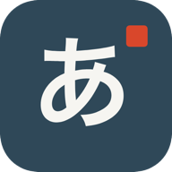
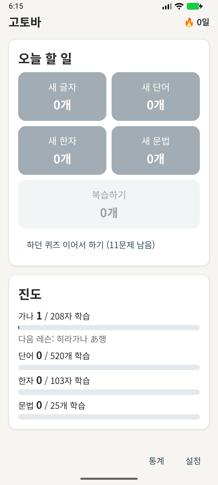

# 고토바

가나부터 시작하는 일본어 학습 앱입니다. 매일 조금씩 배우고, 간격 반복으로 복습합니다. 한국어로 설명하며 회원가입 없이 사용할 수 있습니다.

현재 Android 첫 공개를 준비하고 있습니다. 설치 APK는 아직 일반에 공개하지 않았습니다. 공개 후 [릴리스 목록](https://github.com/svmark/kotoba/releases)에서 받을 수 있습니다.

## 공부할 수 있는 내용

| 코스 | 내용 |
|---|---|
| 가나 | 히라가나·가타카나 208자, 글자별 예시 단어와 발음 |
| 단어 | 기초 단어 520개, 뜻·읽기·소리 퀴즈 |
| 한자 | 기초 한자 103자, 획순 애니메이션·훈음·읽기 |
| 문법 | 기초 문법 25항목, 후리가나 예문과 빈칸 퀴즈 |

배운 글자에 맞춰 읽을 수 있는 단어부터 열립니다. 새 학습량과 가나 학습 순서를 정할 수 있고, 복습 알림·학습 통계·기록 백업을 제공합니다.

N5는 학습 범위를 설명하기 위한 비공식 수준 표시입니다. JLPT 공식 앱이나 공식 목록이 아닙니다.

## Android 설치

첫 버전 공개 후 릴리스의 Assets에서 `kotoba.apk`를 내려받아 설치합니다. `Source code` 압축 파일은 설치 파일이 아닙니다. Google Play를 거치지 않으므로 브라우저나 파일 앱에서 ‘이 출처 허용’이 필요할 수 있습니다.

- [설치·업데이트 안내](INSTALL.md)
- [릴리스 목록](https://github.com/svmark/kotoba/releases)
- [버전별 변경 사항](CHANGELOG.md)

현재 최소 OS 설정은 Android 7 이상입니다. 모든 해당 기기에서 확인한 것은 아닙니다. 출시용 APK는 에뮬레이터에서 설치·학습·업데이트 후 기록 유지를 확인했고, 일반 실기기 최종 확인이 남아 있습니다. 공개 초기에는 기기에 따라 불편한 점이 있을 수 있습니다.

## 기록과 발음

학습 기록은 기기별로 저장됩니다. 앱에서 기기 간 자동 동기화는 제공하지 않습니다. 기기를 바꾸거나 앱을 삭제하기 전에 설정에서 학습 기록을 백업해 주세요. 백업에는 학습 기록이 담기며 앱 설정과 진행 중 퀴즈 전체를 복제하는 기능은 아닙니다.

발음은 기기의 일본어 음성 엔진을 사용합니다. 일본어 음성 데이터 설치가 필요할 수 있고, 음질과 인터넷 사용 여부는 기기·엔진 설정에 따라 달라집니다.

## 문의와 출처

- [오류 제보·기능 제안](SUPPORT.md)
- [개인정보 안내](PRIVACY.md)
- [공개 데이터와 소프트웨어 출처](THIRD-PARTY-NOTICES.txt)

이 저장소는 사용자 안내와 배포 파일을 제공합니다. 앱 개발 소스는 공개하지 않습니다. 포함 공개 데이터에는 각각의 라이선스가 적용됩니다.

문서 작성: Codex (GPT-6)
